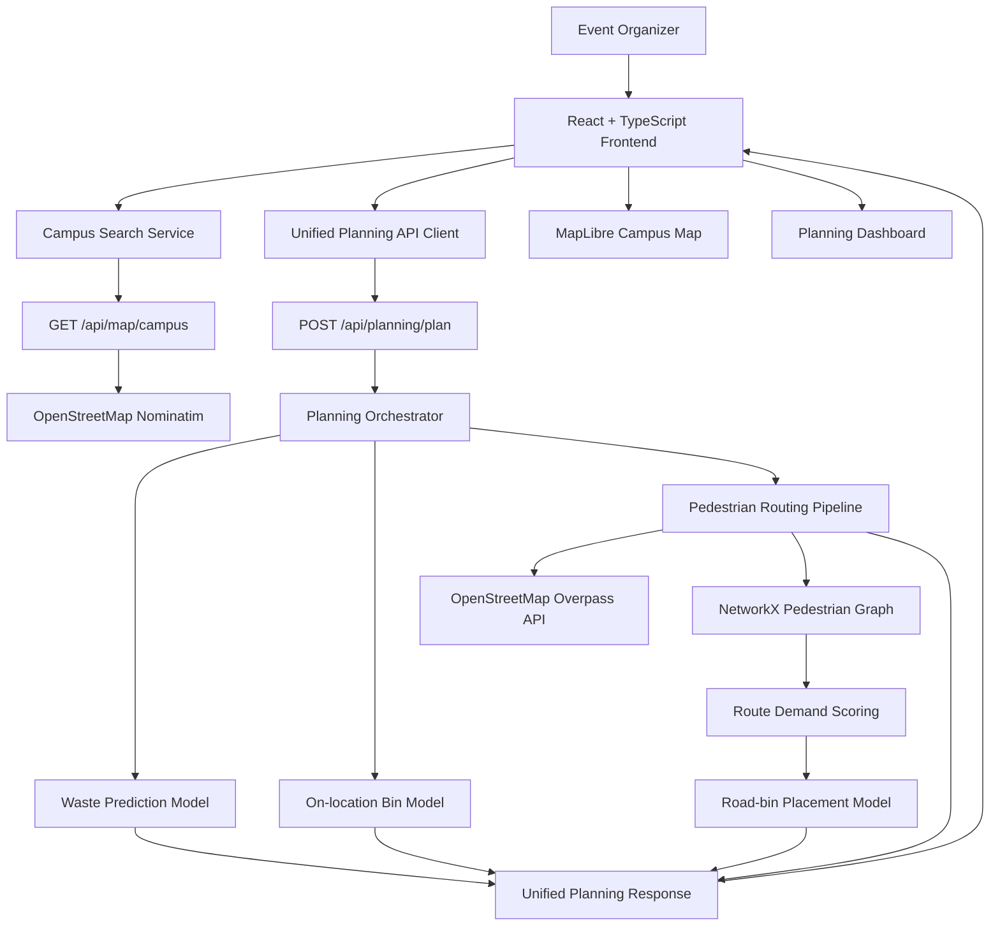
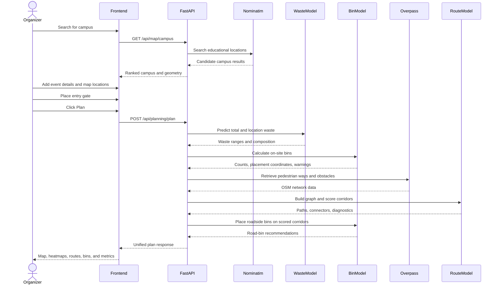

# Bunbetsu: Intelligent Waste Planning for College Festivals

## Project Summary

Bunbetsu is an intelligent waste-management and spatial-planning platform for college festivals and campus events.

During a large fest, thousands of people gather in a relatively small area. Food stalls, concerts, sports activities, exhibitions, and workshops create different kinds of waste in different quantities. However, waste planning often starts only after the event has begun. Organizers may not know how much waste to expect, how many bins are required, where bins should be placed, or which pedestrian routes will receive the most traffic.

Bunbetsu addresses this problem before the event starts. An organizer selects a campus, configures the event, marks event zones, assigns activities, places the entry gate, and generates a complete plan. The application predicts the amount and composition of waste, recommends bin counts, places bins spatially on the campus map, evaluates pedestrian corridors, and recommends additional roadside bin stations.

The project was built for the AWS Build Bharat Hackathon under the Waste and Energy theme.

---

## Introduction and Problem Statement

College festivals are temporary cities. For a few days, a campus may receive thousands of visitors, and every activity produces a different waste profile:

- Food stalls produce organic waste, packaging, and disposable cutlery.
- Concerts produce bottles, cups, wrappers, and event material.
- Sports activities produce bottles, food packaging, and athletic consumables.
- Literary, fine-arts, and exhibition areas produce paper, cardboard, and craft material.
- Hackathons produce food packaging, coffee cups, paper, and electronic waste.

The main problem is that waste-management decisions are usually reactive. Organizers often place bins based on intuition or convenience. This leads to several issues:

1. Too few bins in high-footfall areas.
2. Too many bins in low-demand areas.
3. Poor separation between recyclable and disposable waste.
4. Bins placed far away from the routes that people actually use.
5. No estimate of collection frequency or emptying requirements.
6. No clear understanding of the waste generated by each event zone.

There is also a data problem. A new college festival usually does not have a large, clean, event-specific historical dataset that can immediately train a reliable machine-learning model. Waiting for such a dataset would mean waiting before building a solution.

Bunbetsu therefore starts with an evidence-backed mathematical model. It uses CPCB state and Union Territory waste-generation benchmarks, activity-specific contribution weights, activity intensity ranges, and waste-composition assumptions. The model is deterministic, transparent, and auditable. As real event data becomes available, the platform can later use it to improve its predictions.

The goal is not only to answer, "How much waste will this event create?" The goal is also to answer:

- Where should bins be placed?
- How many bins are needed in each zone?
- How often should they be emptied?
- Which waste streams require separate capacity?
- Which pedestrian corridors are likely to be important?
- Where should additional roadside bins be installed?

---

## Solution Overview

Bunbetsu combines four planning capabilities:

1. **Waste prediction**: Estimates total waste and category-wise waste.
2. **On-location bin planning**: Converts predicted waste into bin counts and coordinates inside event zones.
3. **Pedestrian route analysis**: Builds a campus walking network from OpenStreetMap data and scores important corridors.
4. **Road-bin planning**: Uses route popularity and waste influence areas to recommend bins along pedestrian paths.

The complete operation is exposed through the unified endpoint:

```text
POST /api/planning/plan
```

The backend executes the stages directly in Python and returns prediction results, bin recommendations, routes, road-bin recommendations, warnings, and diagnostics in one response.

---

## Tech Stack and Why We Chose It

### Frontend

#### React and TypeScript

React provides a component-based structure for the multi-step planning workflow. TypeScript gives us explicit contracts for campuses, event locations, prediction results, bin recommendations, route data, and GeoJSON objects.

Important frontend contracts are defined in:

```text
frontend/src/types/bunbetsu.ts
```

TypeScript was especially useful because the project passes complex spatial data between the map, frontend services, and backend APIs.

#### Vite

Vite provides a fast development server, efficient builds, and a simple proxy from the frontend to the FastAPI backend.

#### MapLibre GL

MapLibre GL powers the interactive campus map. It was selected because it supports:

- GeoJSON layers.
- Polygon and MultiPolygon rendering.
- Interactive markers.
- Custom map layers.
- Clickable paths and zones.
- Route and heatmap overlays.
- Open map tile sources.

#### Tailwind CSS

Tailwind CSS allows the interface to be developed quickly while keeping spacing, colors, responsive layouts, and map overlays consistent.

#### Turf and polygon-clipping

These libraries support geographic operations in the browser, including:

- Checking whether an entry gate is inside the campus.
- Checking whether a drawn event polygon is contained within the campus boundary.
- Calculating approximate polygon areas.
- Creating the visual mask outside the campus.

### Backend

#### FastAPI

FastAPI was chosen because it provides:

- Typed request and response models.
- Automatic validation through Pydantic.
- Clear API route organization.
- Easy integration with asynchronous HTTP calls.
- Automatic OpenAPI documentation.

#### Python

Python is well suited for the mathematical, GIS, graph, and optimization parts of the project. It also provides mature libraries for geometry and network analysis.

#### Pydantic

Pydantic validates event data, coordinates, GeoJSON geometry, unique location IDs, unique location names, routing configuration, and entry-gate placement.

#### Shapely

Shapely handles:

- Polygon validation.
- Polygon containment.
- Boundary measurement.
- Inward buffering.
- Geometry intersection.
- Nearest points.
- Obstacle-crossing checks.

#### PyProj

PyProj converts latitude and longitude into a local metric projection. This allows the application to calculate distances, perimeters, spacing, and route lengths in metres rather than degrees.

#### NetworkX

NetworkX represents the campus pedestrian network as a graph. Locations become graph nodes, walkable OSM ways become graph edges, and route demand is assigned to mapped edges.

#### NumPy and SciPy

NumPy supports numerical operations. SciPy is available for optimization routines used by the broader bin-placement implementation.

#### OpenStreetMap Nominatim

Nominatim is used to search for a college or university and retrieve its coordinates, address, state, country, and available boundary geometry.

#### OpenStreetMap Overpass API

Overpass is used to retrieve walkable ways, buildings, and barriers within the campus area. The application then filters and processes this data locally.

---

## Architecture



### Repository Structure

```text
bunbetsu/
├── backend/
│   ├── server.py
│   ├── api/
│   ├── map/
│   ├── models/
│   │   ├── waste_predictor_model/
│   │   └── bin_distribution_model/
│   ├── planning/
│   └── routes/
├── frontend/
│   ├── src/
│   │   ├── components/
│   │   ├── services/
│   │   ├── types/
│   │   └── utils/
│   └── test/
├── README.md
└── writeup.md
```

### End-to-End Workflow



---

## Main Features

### 1. Campus Search

The organizer searches by college or university name. Bunbetsu retrieves several OpenStreetMap results and ranks them using education-related tags, campus keywords, and polygon availability.

The selected campus provides:

- Campus name.
- Full address.
- City and state.
- Coordinates.
- Approximate campus area.
- Polygon or MultiPolygon boundary when available.
- OpenStreetMap source metadata.

### 2. Interactive Campus Map

The map supports:

- Campus boundary visualization.
- Campus isolation mode.
- Location selection.
- Custom polygon drawing.
- Area calculation.
- Polygon containment validation.
- Custom-area deletion.
- Entry-gate placement.
- Activity markers.
- Bin markers.
- Road-bin markers.
- Pedestrian route layers.
- Heatmap layers.
- Route and location inspection.

### 3. Event Configuration

The organizer enters:

- Event name.
- Event duration.
- Expected daily footfall.
- Active event zones.
- Activities assigned to each zone.
- Campus entry gate.

The application validates positive duration, positive footfall, valid areas, unique location names, unique location IDs, and at least one activity per location.

### 4. Waste Prediction

The prediction model returns:

- Low, central, and high total waste.
- Waste in kilograms and tonnes.
- Waste by category.
- Recyclable waste.
- Disposable waste.
- Activity-level allocations.
- Location-level allocations.
- Baseline rate and source information.
- Model assumptions.
- Heatmap values.

### 5. Waste Heatmaps

The dashboard provides separate heatmap modes for:

- Total waste.
- Food.
- Plastic.
- Paper.
- Glass.
- Others.
- Recyclable waste.
- Disposable waste.

Missing data is shown as missing rather than silently being treated as zero.

### 6. On-Site Bin Recommendations

For each polygon event zone, the system calculates:

- Capacity-only bin demand.
- Final physical bin count.
- Disposable bin count.
- Recyclable bin count.
- Required emptying turns.
- Daily volume demand.
- Available capacity.
- Capacity shortfall.
- Perimeter spacing.
- Actual placement spacing.
- Placement warnings.
- Exact map coordinates.

### 7. Entry Gate Planning

The entry gate is mandatory before generating a plan. It must be placed inside the campus boundary.

The gate is also included in pedestrian-route analysis as an additional origin point. The dashboard includes gate-related bin capacity in its event-level summary.

### 8. Pedestrian Route Analysis

The routing system displays:

- Mapped pedestrian paths.
- Inferred location connectors.
- Flagged connectors that cross buildings or barriers.
- High-priority junctions.
- Route demand color coding.
- Total graph length.
- Connected route pairs.
- Unreachable pairs.
- Graph node and edge counts.

### 9. Roadside Bin Recommendations

The system recommends additional bins along pedestrian corridors. These recommendations consider:

- Route popularity.
- Activity-location influence radii.
- Waste stream requirements.
- Candidate points along mapped paths.
- Minimum spacing.
- Locations that are covered or remain uncovered.

### 10. Partial Results and Diagnostics

The platform does not discard successful results when one stage fails. For example, if Overpass is unavailable:

- Waste prediction can still be returned.
- On-site bins can still be returned.
- Routing is marked as failed.
- The frontend displays a non-blocking route warning.

The response reports stage status for prediction, bins, and routes.

---

## Screenshot Placeholders

The following screenshots can be added later. Suggested screenshots are listed with the product behavior they should demonstrate.

### Screenshot 1: Authentication Page

`[Add screenshot here: Login and guest access screen]`

Suggested file name:

```text
screenshots/auth-page.png
```

### Screenshot 2: Campus Search

`[Add screenshot here: Campus search overlay with campus boundary and result card]`

Suggested file name:

```text
screenshots/campus-search.png
```

### Screenshot 3: Event Configuration

`[Add screenshot here: Event form, map toolbar, entry gate, and event locations]`

Suggested file name:

```text
screenshots/event-configuration.png
```

### Screenshot 4: Waste Heatmap

`[Add screenshot here: Total waste or category heatmap on the campus]`

Suggested file name:

```text
screenshots/waste-heatmap.png
```

### Screenshot 5: Bin Placement

`[Add screenshot here: On-site and roadside bin markers on the map]`

Suggested file name:

```text
screenshots/bin-placement.png
```

### Screenshot 6: Pedestrian Routes

`[Add screenshot here: Colored pedestrian corridors, connectors, and priority junctions]`

Suggested file name:

```text
screenshots/pedestrian-routes.png
```

### Screenshot 7: Planning Dashboard

`[Add screenshot here: Final three-column planning dashboard]`

Suggested file name:

```text
screenshots/planning-dashboard.png
```

---

## Technical Implementation

### Unified Planning Request

The frontend sends one request containing event details, the campus boundary, entry gate, and active event locations.

```typescript
const payload = {
  fest_name: eventDetails.festName.trim(),
  total_footfall: eventDetails.expectedFootfall,
  duration_days: eventDetails.durationDays,
  campus_state: campus.state.trim(),
  campus_boundary: campus.geometry,
  entry_gate: {
    id: entryGate.id,
    name: entryGate.name,
    coordinates: entryGate.coordinates,
  },
  locations: locations.map((location) => ({
    id: location.id,
    name: location.name.trim(),
    area: location.area,
    activities: location.activities,
    geometry: location.geometry,
    center: location.center,
  })),
};
```

This keeps the waste, bin, and route calculations synchronized. The frontend client is implemented in:

```text
frontend/src/services/planningApi.ts
```

### Waste Prediction Formula

The core model is:

$$
W = F \times D \times R \times I
$$

Where:

- $F$ = expected daily footfall.
- $D$ = number of event days.
- $R$ = CPCB baseline waste rate.
- $I$ = weighted activity intensity.

The model first calculates attendee-days:

$$
A = F \times D
$$

It then applies a low, central, and high activity-intensity range.

```python
attendee_days = inputs.total_footfall * inputs.duration_days

waste = Range(
    attendee_days * baseline_rate * intensity.low,
    attendee_days * baseline_rate * intensity.central,
    attendee_days * baseline_rate * intensity.high,
)
```

The range makes uncertainty visible instead of presenting one unnecessarily precise number.

### Activity Weighting

Each activity has a predefined relative contribution weight and intensity range.

```python
ACTIVITY_WEIGHTS = {
    "Food Stalls": 5,
    "Music Concert": 4,
    "Performing Arts": 3,
    "Literary & Fine Arts": 2,
    "Sports": 1,
    "Hackathon": 1,
}
```

These weights are planning parameters. They are not claims about the exact number of people attending each activity.

### Location Allocation

Waste is allocated across locations according to the sum of their activity weights.

```python
share = location_activity_weight / total_activity_weight
location_waste = total_waste * share
```

The location area is retained for spatial planning, but it is not used as a direct waste multiplier.

### Converting Waste into Bin Demand

The bin model first converts mass into volume:

$$
V = \sum_i \frac{M_i}{\rho_i}
$$

Where:

- $M_i$ is the mass of waste category $i$.
- $\rho_i$ is the category density.
- $V$ is the estimated volume.

The model uses 100-litre bins with an 80% usable fill fraction:

$$
C_{usable} = 100 \times 0.80 = 80\text{ litres}
$$

Capacity-only demand is calculated as:

$$
N = \left\lceil \frac{V_{daily}}{80} \right\rceil
$$

### Perimeter-Constrained Placement

The final physical count is limited by a configured spacing policy:

$$
M = \left\lfloor \frac{P}{d} \right\rfloor
$$

Where:

- $P$ is the approximate location perimeter.
- $d$ is the 25-metre spacing policy.
- $M$ is the maximum physical bin count under that policy.

When demand is higher than the physical count, the model allocates bins between Disposable and Recyclable streams using a deterministic largest-remainder method and calculates additional emptying turns.

Placement coordinates are sampled on an inward-offset exterior boundary so that bins remain inside the location polygon.

### Pedestrian Graph Construction

The routing pipeline:

1. Retrieves OSM ways within a buffered campus bounding box.
2. Filters eligible pedestrian ways.
3. Projects coordinates into local metres.
4. Clips ways to the campus boundary.
5. Creates a NetworkX graph.
6. Preserves OSM nodes and way topology.
7. Adds activity connectors by splitting nearby edges.
8. Excludes connectors from mapped-road popularity scoring.

### Shortest and Alternative Paths

For each connected pair of activity locations, the route scorer finds the shortest path and bounded alternative loopless paths. The implementation uses NetworkX's weighted simple-path generator, which provides Yen-style k-shortest-path behavior while limiting paths by distance and count.

Alternative paths are weighted using exponential distance decay:

$$
P_k = \frac{e^{-\Delta_k / \lambda}}{\sum_j e^{-\Delta_j / \lambda}}
$$

Where:

- $\Delta_k$ is the additional length of path $k$ beyond the shortest path.
- $\lambda$ controls how quickly longer alternatives lose importance.

A pair's attraction is based on the geometric mean of its endpoint activity weights:

$$
A_{ab} = \sqrt{w_a \times w_b}
$$

The pair contribution is distributed across eligible paths, and each mapped road segment accumulates the demand passing through it.

Finally, segment scores are normalized to the range `[0, 1]` for map visualization.

### Campus Search Ranking

OpenStreetMap can return multiple results for the same or similar campus query. Bunbetsu ranks candidates using signals such as:

- Educational OSM class.
- University, college, school, or campus type.
- Campus-related keywords in the display name.
- Polygon or MultiPolygon geometry availability.

The ranking is implemented in:

```text
backend/map/campus.py
```

The application uses structured address fields to identify the state rather than relying only on comma-separated display-name text.

---

## Challenges and Solutions

### Challenge 1: No Suitable Event-Waste Dataset

The first challenge was the absence of a complete, public, college-festival-specific dataset. A conventional supervised machine-learning model would require reliable historical examples containing footfall, event type, duration, waste categories, location, and collection records. Such a dataset was not available at the beginning of the project.

#### Solution

Instead of waiting for a perfect dataset, we created a transparent mathematical baseline model. We researched waste-generation references, activity behavior, and material composition assumptions. The model uses:

- CPCB state and UT municipal solid-waste benchmarks.
- Activity contribution weights.
- Activity-specific intensity bands.
- Activity-specific composition priors.
- Low, central, and high output ranges.

This approach gives organizers an explainable starting point. Every result includes assumptions and source metadata, and the model is structured so real observations can be used for future calibration.

The model deliberately avoids pretending that its estimates are exact measurements. It labels CPCB values as reference baselines and separates mathematical prediction from future machine-learning or RAG components.

### Challenge 2: Turning Bin Counts into Map Placements

A simple bin model could return only a number, but event organizers need to know where bins should physically go. A count without coordinates is difficult to operationalize.

The project also had to account for:

- Location geometry.
- Different waste streams.
- Available perimeter length.
- Minimum spacing.
- Small or narrow polygons.
- MultiPolygon locations.
- Emptying frequency.

#### Solution

The bin model converts waste mass into volume, calculates capacity demand, applies the 25-metre planning spacing policy, and samples points along an inward-offset boundary. This produces map-ready coordinates while keeping the markers inside the event area.

The model also distinguishes capacity demand from physical placement capacity. If an area cannot hold enough bins under the spacing policy, the model reports emptying turns and capacity shortfalls rather than silently creating unrealistic placements.

### Challenge 3: Selecting the Entry Gate and Connecting Event Zones

Pedestrian routes need an origin and destinations. The entry gate is especially important because it is the main source of incoming visitors and waste movement.

#### Solution

The frontend requires the organizer to place an entry gate inside the campus boundary. The gate is validated with geographic containment logic and then passed into the routing pipeline as a Point location.

This lets the route model evaluate connections between the gate and event areas as well as connections between event areas.

### Challenge 4: Finding Important Roads, Not Only One Shortest Path

Using only one shortest path can underestimate the importance of alternate corridors. People may use multiple paths because of crowding, accessibility, barriers, or convenience.

#### Solution

Bunbetsu evaluates bounded alternative paths instead of using only one route. Paths within a configured additional-distance tolerance are considered, and longer alternatives receive lower exponential weights.

The model then creates a popularity index for mapped road segments. More popular corridors receive higher normalized scores and become stronger candidates for roadside bin placement.

The implementation is not a simple statement that every popular road receives more bins. It combines corridor popularity, minimum spacing, event-zone influence radii, waste streams, and coverage requirements.

### Challenge 5: No College Map or Pedestrian-Network Dataset

Each college has a different layout. Campus boundaries and pedestrian routes are not consistently available in a single application-specific dataset.

#### Solution

Bunbetsu uses OpenStreetMap services:

- Nominatim searches for the campus and retrieves boundary geometry.
- Overpass retrieves local roads, paths, buildings, and barriers.
- Local processing constructs a campus-specific graph.

The system caches Overpass responses temporarily and retries selected upstream failures. It also returns warnings when the map contains no eligible pedestrian paths or when locations cannot be connected.

### Challenge 6: Multiple OpenStreetMap Search Results

A search such as a college name can return several results: the university, a department building, a nearby road, a neighborhood, or another similarly named place.

#### Solution

Bunbetsu ranks candidates using OSM metadata and name signals. Results with education-related types, campus-related keywords, and actual polygon geometry receive higher scores. This increases the chance that the selected result represents the complete campus rather than one building or point.

The state is extracted from structured Nominatim address fields such as `state`, `province`, and `region`, which is more reliable than guessing from the formatted display name.

### Challenge 7: Geometry and Coordinate Reliability

Map data can contain invalid polygons, narrow areas, disconnected components, or coordinates near boundaries. A small geometry error could place a bin outside an event zone or accept an entry gate outside the campus.

#### Solution

The project validates GeoJSON structures and coordinate ranges at the API boundary. It uses Shapely and frontend geographic utilities for:

- Ring closure.
- Positive-area checks.
- Polygon containment.
- Point-in-campus checks.
- Boundary intersections.
- Inward-buffer validation.
- Returned-coordinate validation after rounding.

### Challenge 8: External Services Can Fail

Nominatim and Overpass are external public services. They can time out, rate-limit requests, return no data, or temporarily fail.

#### Solution

The project includes:

- Request timeouts.
- Bounded retries.
- In-memory Overpass caching.
- Explicit HTTP error responses.
- Route-stage warnings.
- Partial pipeline results.

Waste and on-site bin results can remain available even if pedestrian routing fails.

---

## Testing

The project includes both backend and frontend tests.

### Backend Testing

Backend tests cover:

- API validation.
- Campus lookup behavior.
- Waste-model output structure.
- Waste-model mathematical behavior.
- Unified planning output.
- Stable location IDs.
- Polygon and MultiPolygon placement.
- Point-location handling.
- Duplicate location names.
- Missing campus boundaries.
- Route failure behavior.
- Bin-model failure behavior.
- OSM access filtering.
- Graph construction.
- Connector splitting.
- Route scoring.

The unified planning tests verify that prediction, bin placement, and routing receive compatible data and that the response remains consistent with the frontend contract.

### Frontend Testing

Frontend tests cover:

- Exactly one unified planning request.
- Payload structure.
- Stable IDs.
- Duplicate-name validation.
- Missing-state validation.
- Response mapping.
- Heatmap normalization.
- Polygon drawing and erasing.
- Road-bin recommendation integration.
- Location-aware bin recommendations.
- Entry-gate behavior.
- Campus isolation.
- Dashboard navigation and empty states.

### Example Test Commands

```bash
python -m pytest -c backend/pytest.ini backend
npm --prefix frontend run lint
npm --prefix frontend run build
npm --prefix frontend test
```

---

## Deployment

### Local Development

Backend dependencies are defined in:

```text
backend/requirements.txt
```

Start the backend:

```bash
pip install -r backend/requirements.txt
uvicorn server:app --app-dir backend --reload --port 8000
```

On macOS, a virtual environment can be activated with:

```bash
source backend/.venv/bin/activate
```

Start the frontend:

```bash
cd frontend
npm install
npm run dev
```

The frontend runs on port `3000` and proxies `/api` requests to the backend on port `8000`.

### Environment Variables

```text
VITE_API_BASE_URL
OVERPASS_API_URL
```

`VITE_API_BASE_URL` can point the frontend to a deployed backend. `OVERPASS_API_URL` can select an alternate Overpass endpoint.

### Deployment Considerations

For production deployment, the following improvements are recommended:

- Use a production ASGI server configuration.
- Put the API behind HTTPS.
- Configure specific CORS origins instead of allowing all origins.
- Add persistent caching for OpenStreetMap data.
- Add rate-limit protection.
- Add monitoring for Nominatim and Overpass failures.
- Store event plans in a database.
- Replace simulated authentication with a real identity provider.
- Use a managed tile provider or self-host map tiles if traffic grows.
- Move long-running route calculations to background jobs for large campuses.

---

## Results

Bunbetsu produces a practical pre-event plan containing:

- Total expected waste range.
- Waste composition.
- Recyclable and disposable totals.
- Location-level waste allocations.
- On-site bin counts.
- Disposable and recyclable bin counts.
- Emptying-turn requirements.
- Capacity shortfalls.
- On-site bin coordinates.
- Road-bin coordinates.
- Pedestrian corridor popularity scores.
- Connected and unreachable route pairs.
- Important junctions.
- Warnings and assumptions.

The most important result is that the output is spatial. Instead of returning only a waste number, Bunbetsu connects the estimate to a campus map and gives the organizer an operational layout to review.

The current project does not claim that these values replace on-ground verification. The model explicitly identifies assumptions, and final placements should be checked against accessibility, emergency routes, collection access, doors, utilities, crowd-control barriers, and local operational rules.

---

## Key Learnings

### 1. A Missing Dataset Should Not Stop the First Version

One of the biggest lessons was that a useful solution cannot always wait for a perfect dataset. In a new problem area, there may be no clean historical data at the beginning.

The practical approach is to:

- Research credible reference data.
- Make assumptions explicit.
- Build a deterministic baseline.
- Show uncertainty ranges.
- Capture real observations from early usage.
- Improve the model over time.

A transparent baseline is more useful than an unexplained prediction or an unfinished product waiting for ideal data.

### 2. A Prediction Is More Useful When It Leads to an Action

Predicting kilograms of waste is only one part of the problem. The result becomes more useful when it is connected to:

- Bin types.
- Physical locations.
- Emptying requirements.
- Pedestrian movement.
- Coverage warnings.

This shaped the decision to build the map, bin-distribution model, and route pipeline together.

### 3. Uncertainty Should Be Visible

The project uses low, central, and high values instead of presenting a single number as absolute truth. This helps organizers plan for variation and understand which assumptions affect the result.

### 4. External Geographic Data Needs Validation

OpenStreetMap provides valuable coverage, but it is not guaranteed to be complete or uniform. The system must validate geometry, filter unsuitable paths, preserve topology, and explain missing or disconnected results.

### 5. Partial Success Is Better Than Total Failure

A real planning tool should continue showing valid waste and bin information even when a third-party routing service fails. Stage-level diagnostics make the output more trustworthy and easier to debug.

---

## Future Scope

### 1. Add Existing Campus Bins

Most colleges already have permanent bins, collection points, composting areas, and waste rooms. A future version can allow the organizer to upload or draw existing infrastructure:

- Existing bin coordinates.
- Bin type.
- Capacity.
- Current condition.
- Collection schedule.
- Waste stream.
- Accessibility constraints.

Bunbetsu could then calculate only the additional bins required for the festival instead of planning from zero.

### 2. Learn from Actual Event Data

After each event, organizers could record:

- Actual collected waste by category.
- Actual footfall.
- Actual bin fill times.
- Overflow events.
- Collection trips.
- Locations with contamination.
- Crowd movement observations.

This data could be used to calibrate activity weights, baseline rates, material densities, influence radii, and emptying requirements. Over time, the model could move from general priors to campus-specific and event-specific predictions.

### 3. Real-Time Fill-Level Monitoring

IoT fill-level sensors could report bin status during the event. The system could alert staff when:

- A bin is close to capacity.
- A high-demand corridor needs service.
- A recyclable bin is contaminated.
- A location is producing more waste than expected.

### 4. Dynamic Route and Collection Planning

The same pedestrian graph could support operational collection routing. Collection teams could receive a route that prioritizes:

- Full bins.
- High-popularity corridors.
- Short travel distance.
- Accessible service paths.
- Time-sensitive waste zones.

### 5. Better Crowd and Footfall Inputs

Future versions could accept:

- Hourly footfall instead of only daily footfall.
- Event schedules.
- Ticketing data.
- Entry scans.
- Crowd-density estimates.
- Venue capacity.
- Peak-hour forecasts.

This would improve both waste prediction and route demand scoring.

### 6. Accessibility and Safety Constraints

Route and bin placement can be improved by adding:

- Wheelchair-accessible paths.
- Emergency exits.
- Fire lanes.
- Service-road restrictions.
- Stairs and slopes.
- Doorways and building entrances.
- Temporary barriers.
- Crowd-control zones.

### 7. More Detailed Waste Streams

The current model separates Disposable and Recyclable streams for bin planning. Future versions could add:

- Compostable waste.
- E-waste.
- Sanitary waste.
- Glass-specific collection.
- Cooking oil.
- Hazardous event waste.
- Reusable-cup or deposit-return systems.

### 8. Multi-Event and Multi-Campus Management

Institutions could manage several festivals, compare plans, reuse campus templates, and maintain a long-term waste-management profile for each campus.

### 9. Save, Export, and Share Plans

Future versions can add:

- PDF export.
- CSV waste schedules.
- Printable bin-placement maps.
- Staff assignments.
- Vendor instructions.
- Shareable plan links.
- Event version history.

### 10. Model Calibration and Explainable Machine Learning

As data accumulates, machine-learning models can be introduced carefully. The deterministic model can remain a baseline and fallback, while learned models provide campus-specific corrections with explanations and confidence intervals.

### 11. Weather and Seasonal Factors

Weather can affect waste and movement. Future planning could incorporate:

- Rain probability.
- Temperature.
- Outdoor versus indoor activity.
- Seasonal food and beverage demand.
- Temporary route closures.

### 12. Sustainability Impact Reporting

Bunbetsu could estimate:

- Diversion from landfill.
- Recycling rate.
- Compostable waste recovered.
- Collection distance saved.
- Estimated emissions avoided.
- Reduction in overflow incidents.

This would help institutions measure the environmental impact of their events.

---

## GitHub, Live Demo, and Project Links

### GitHub Repository

`[Add GitHub repository link here]`

```text
GitHub: __________________________________________
```

### Live Demo

`[Add live demo link here]`

```text
Live demo: _______________________________________
```

### Project Documentation

- Main project README: [README.md](README.md)
- Frontend README: [frontend/README.md](frontend/README.md)
- Backend entry point: [backend/server.py](backend/server.py)
- Unified planning API: [backend/planning/planner_service.py](backend/planning/planner_service.py)

---

## Conclusion

Bunbetsu turns festival waste planning from a reactive task into a pre-event planning workflow.

The application combines an explainable waste model, a geographic interface, polygon-aware bin placement, OpenStreetMap pedestrian data, route popularity scoring, and roadside-bin recommendations. It helps organizers understand not only how much waste an event may generate, but also where waste infrastructure should be placed and which areas may need greater operational attention.

The project began with a practical constraint: there was no perfect dataset available for training a festival-specific model. Instead of treating that as a reason to stop, we built a transparent baseline using CPCB data, documented assumptions, and uncertainty ranges. The architecture is designed to improve as real event data becomes available.

Bunbetsu is therefore both a working planning tool and a foundation for a more data-driven campus sustainability system. It provides immediate value today while creating a path toward sensor-driven monitoring, campus-specific learning, smarter collection routing, and measurable waste reduction in future events.
